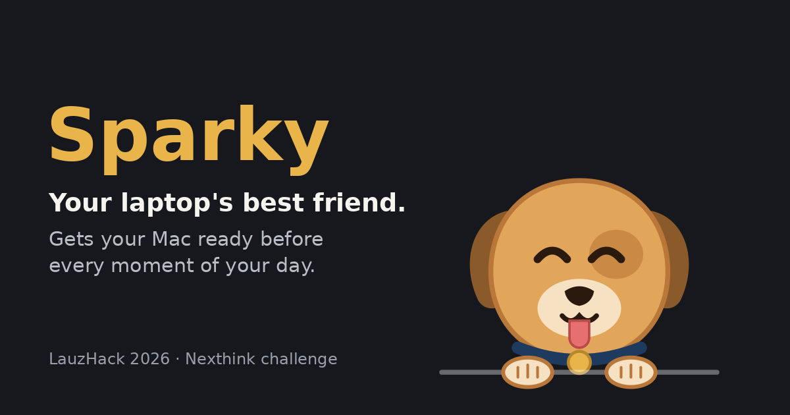

# Sparky 🐶

> **Laptop not ready when you are? Sparky is.** Your AI dog for a frictionless workday.



Built in one weekend, solo, for **LauzHack 2026 · Nexthink challenge** (*an AI that makes tech at work less painful*).

## What it does

Most tech pain at work isn't a crash: it's the minutes lost before every block of your day. Sparky is a little dog peeking over the edge of your screen that fixes this **before** it happens, driven by your calendar.

| When | What Sparky does |
|---|---|
| **Morning** | You tell it your day in one sentence; an LLM fits your tasks between your calendar's meetings. Tells you what to take with you (HDMI adapter, charger). |
| **5 min before each block** (meeting *or* focus block) | Checks the Mac against what the block needs (external screen when you present, Wi-Fi, battery), closes heavy apps and tabs you don't need (LLM triage + guardrails that always keep work sites), opens what you do: Zoom directly, the right document, the right GitHub tab, meeting notes pre-filled from the invite. |
| **Free slot** | "Grab a coffee, I'm tidying up your Mac": measures and cleans rebuildable caches (npm, pip, Homebrew, Gradle, Xcode, Spotify), old downloads to the Trash. |
| **Any time** | Repeated click routines become one-key shortcuts (⌃⌥P / ⌃⌥R / ⌃⌥T / ⌃⌥N) that open company templates and meeting notes. |
| **6 pm** | Sums up the day (time saved, GB freed, issues caught), what's left for tomorrow, and what to pack. |

## Safety first: it acts, never without you

- **The AI proposes, the code checks, you approve.** The LLM only returns JSON; it never runs a command.
- Every action has a **risk level**: `auto` (read-only checks), `1 click` (ticked, runs only when you click), `ask` (unticked, you must choose).
- Everything is **logged with its reason** and can be **undone** (apps and tabs reopen, files go to the Trash).
- **Simulation by default** (`PREFLIGHT_DRY_RUN=1`). No shell: commands run with `execFile` and separate arguments; closed lists of cache folders, URL schemes and file types.

## What's real, what's simulated

Real on the Mac: sensors, calendar (.ics / Outlook link), LLM brief and tab triage, quitting apps, closing tabs, opening Zoom/documents/templates, cache cleanup, undo, journal.
Simulated: the usage log behind the shortcuts (demo data), the macOS update, and "time saved" (an estimate, with its assumptions shown in the app).

## Run it (macOS)

```bash
npm install
cp .env.example .env    # add your Together AI key
npm run dev             # only Sparky shows up, bottom-right
npm run demo:tabs       # optional: a Chrome window of demo tabs
```

## How it's built

Electron + React + TypeScript (electron-vite), Together AI (OpenAI-compatible API, strict JSON schema), node-ical, framer-motion.
`src/main` = the brain (scheduler, planner, LLM agent, action registry, sensors) · `src/renderer` = dashboard, pop-ups and Sparky · `src/shared` = pure, testable logic.

More (in French): [PROJET.md](PROJET.md) · [ARCHITECTURE.md](ARCHITECTURE.md) · [GUIDE.md](GUIDE.md)
